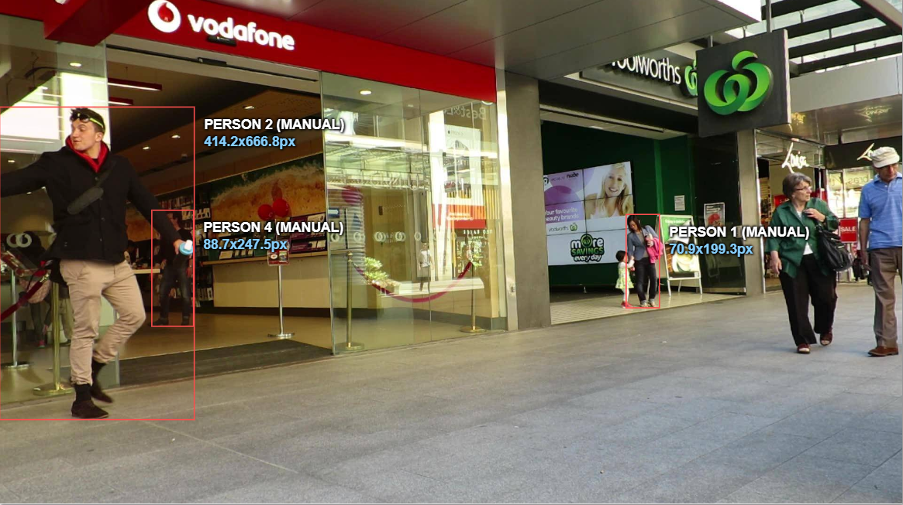
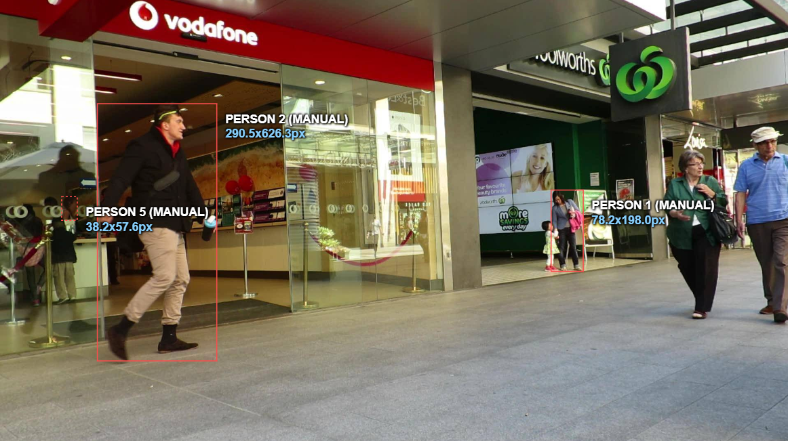
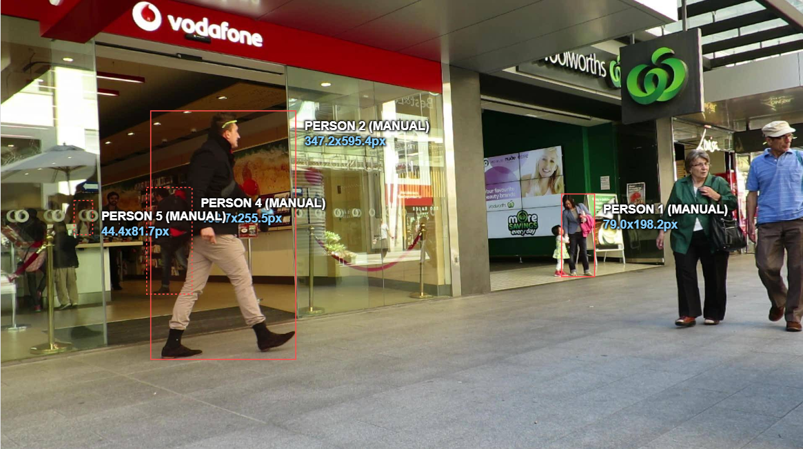
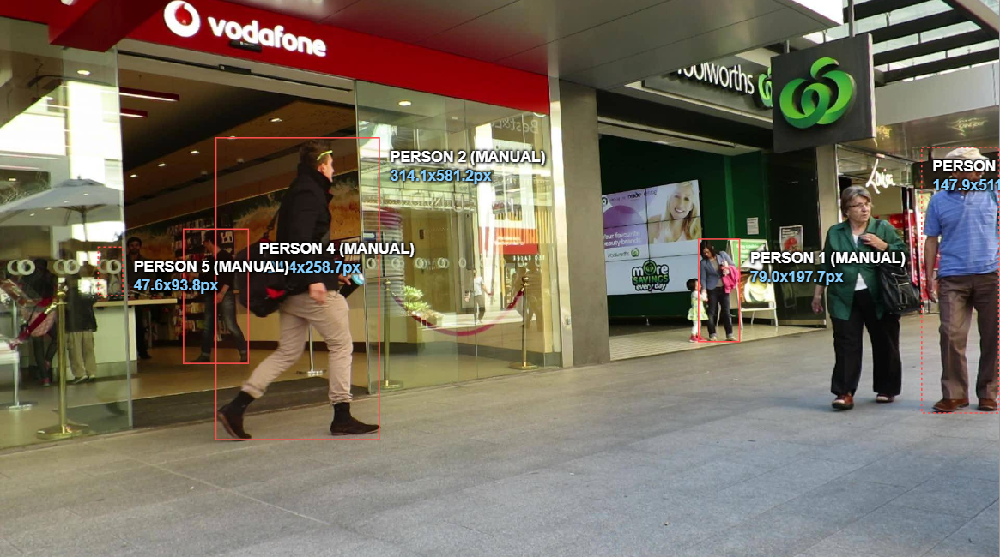

# Báo cáo cá nhân — Hoàng Nhật Anh — 2A202603183

**Bài lab:** Ngày 5 — Gán track ID bằng keyframe và nội suy.

**Dữ liệu:** MOT17-09, 150 frame, 1920 × 1080, 30 fps.

**Nguồn:** MOT17, MOTChallenge (Milan et al., 2016), giấy phép CC BY-NC-SA 3.0.

Báo cáo sử dụng hai ZIP annotation trong `src/exports/`, bốn ảnh minh chứng của học viên và thông tin thời gian do học viên cung cấp. Bản annotation được giữ nguyên; số liệu và các cảnh báo đều được trình bày theo kết quả thực tế.

**Quy ước:** mọi số frame trong báo cáo là frame CVAT **0–149**. Trong MOT `gt/gt.txt`, `frame_id = frame CVAT + 1`.

## 0. Thông tin học viên

| Thông tin | Nội dung |
|---|---|
| Họ tên | Hoàng Nhật Anh |
| MSSV | `2A202603183` |
| Mã đề | **C** |
| Email | `26ai.anhhn2@vinuni.edu.vn` |
| Repository | https://github.com/nhatanhhoang2905/K5-L2-DAY05-HoangNhatAnh-2A202603183-MOTTracking |
| Job trong XML | **20** |
| Nhãn / hình dạng | `person` / rectangle track |
| Ngày thực hành | **13/11/2026** |
| Giờ bắt đầu | **16:30, GMT+7** |
| Giờ kết thúc | **18:50, GMT+7** |
| Tổng thời gian | **140 phút toàn buổi** |
| Tự review | Đã thực hiện **hai lượt**, theo xác nhận của học viên |

Mã đề được xác nhận bằng:

```powershell
.\.venv\Scripts\python.exe src/setup_local_lab.py --mssv 2A202603183 --assignment-only
```

Đề C nhận các MOT ID gốc `[1, 7, 20, 22, 23]`. Mã P1–P5 là thứ tự người trong đề; số ID của XML và MOT bài nộp được đối chiếu như sau:

| Mã người | MOT ID gốc của đề | XML Track ID | MOT Track ID bài nộp |
|---|---:|---:|---:|
| P1 | 1 | 3 | 4 |
| P2 | 7 | 4 | 5 |
| P3 | 20 | 2 | 3 |
| P4 | 22 | 0 | 1 |
| P5 | 23 | 1 | 2 |

Bảng ánh xạ được kiểm tra bằng điểm nhận diện trong `src/lab_variants.json`: P1 tại frame 0, P2 tại 61, P3 tại 40, P4 tại 2 và P5 tại 28. Mỗi điểm nằm trong đúng một box hiện diện tại frame tham chiếu. Trên ảnh minh chứng, **P1 mang nhãn PERSON 4**; PERSON 2 là P5 đang đi ngang phía trước.

## 1. Xem trước đoạn video (CP0)

Bảng dưới tổng hợp phạm vi có box và các đoạn che theo file đã gán. Không có bản ghi CP0 riêng được cung cấp, nên đây là phần khôi phục từ kết quả sau gán, không trình bày như ghi chép đã lập trước khi vẽ. Frame đầu/cuối có box chưa tự chứng minh frame xuất hiện/biến mất thực tế trên hình ảnh.

| Mã | Frame đầu có box | Frame cuối có box | Frame occluded, không outside | Diễn biến hoặc mốc cần chú ý trong dữ liệu |
|---|---:|---:|---|---|
| P1 | 0 | 149 | 25–40, 48–54 | Giữ cùng ID qua đoạn outside 41–47; hiện lại tại 48. |
| P2 | 42 | 149 | 42–87 | Chiều cao box thay đổi mạnh tại frame 45 và 63. |
| P3 | 0 | 149 | 0–6, 8–27, 29–61, 63, 65–66 | Chiều cao box tăng từ 159.4 px ở frame 0 lên 941.8 px ở frame 149. |
| P4 | 0 | 136 | 90–106, 136 | Vắng 107–135; có box lại tại 136 rồi outside từ 137. |
| P5 | 0 | 149 | 109–119, 123–137, 148–149 | Vắng 120–122 và 138–147; người đi ngang trước P1 trong ảnh minh chứng. |

Các mốc rẽ, dừng hoặc đổi tốc độ chưa có ghi chép quan sát riêng. Không suy ra chắc chắn những sự kiện này chỉ từ tọa độ box hay danh sách keyframe. Các đoạn outside được thống kê ở mục 3 và 5.

## 2. Keyframe và thời gian (CP1, CP4)

Số liệu lấy từ `src/check_submission.py`. Script đếm keyframe ở frame có `outside=0`; các keyframe đánh dấu outside không nằm trong tổng keyframe dưới đây.

| Mã | Số keyframe | Keyframe ở frame | Số frame có mặt | KF/100 frame | Thời gian gán (phút) | Chỗ cần chú ý |
|---|---:|---|---:|---:|---|---|
| P1 | 121 | Danh sách bên dưới | 143 | 84.6 | Không có số liệu riêng | Ranh giới occluded/outside và giữ ID trước/sau đoạn che. |
| P2 | 85 | Danh sách bên dưới | 108 | 78.7 | Không có số liệu riêng | Box nhỏ lúc đầu, occluded 42–87; cảnh báo đổi chiều cao tại 45 và 63. |
| P3 | 138 | Danh sách bên dưới | 150 | 92.0 | Không có số liệu riêng | Kích thước box thay đổi lớn; 63 frame occluded và keyframe rất dày. |
| P4 | 35 | Danh sách bên dưới | 108 | 32.4 | Không có số liệu riêng | Các đoạn vắng và lần xuất hiện lại chỉ một frame tại 136. |
| P5 | 118 | Danh sách bên dưới | 137 | 86.1 | Không có số liệu riêng | Di chuyển ngang trước P1; các đoạn outside và occluded ở cuối clip. |
| **Tổng** | **497** | Danh sách bên dưới | **646** | **76.9** | **140 phút toàn buổi; không có thời gian gán riêng** | **4 track vượt 50 KF/100 frame** |

Mật độ keyframe của cả bài:

```text
Tổng keyframe / tổng frame có mặt × 100
= 497 / 646 × 100
≈ 76.9 keyframe / 100 frame.
```

646 là tổng số box cộng theo từng người, không phải độ dài clip. Một frame có đủ năm người đóng góp năm box vào tổng này. Không chia đều 140 phút cho năm người vì thời gian toàn buổi còn có các hoạt động khác và không có ghi chép thời gian riêng.

**Danh sách keyframe:** khoảng “0–30” nghĩa là mọi frame từ 0 đến 30 đều là keyframe.

- **P1 — XML 3/MOT 4:** 0–30, 36–40, 48–70, 72–78, 80–86, 88–90, 92–120, 124–130, 134, 140, 143–149.
- **P2 — XML 4/MOT 5:** 42–56, 58–64, 67–68, 74, 77–78, 80–86, 88–91, 94–124, 126–130, 134, 139–142, 144–149.
- **P3 — XML 2/MOT 3:** 0–32, 34–55, 57–70, 72–82, 85–98, 100–101, 103–108, 110, 112, 114–115, 117–143, 145–149.
- **P4 — XML 0/MOT 1:** 0–12, 15–23, 26, 28, 30–33, 40, 50, 60, 80, 90, 100, 136.
- **P5 — XML 1/MOT 2:** 0, 3–8, 10–19, 21–24, 26–27, 29, 32–39, 41, 43–59, 61–109, 112–119, 123–126, 128–129, 131–132, 136, 148–149.

**Người có nhiều keyframe nhất là P3:** 138 keyframe trên 150 frame có box, tức 92.0/100 frame. P3 có 63 frame occluded và chiều cao box thay đổi lớn từ đầu đến cuối đoạn. Đây là những yếu tố cần chú ý khi điều chỉnh box; chúng chưa đủ chứng minh tất cả 138 mốc đều cần thiết.

Các đoạn keyframe liên tiếp, chẳng hạn P3 ở 0–32 và 117–143, cho thấy bản gán dùng nhiều mốc sát nhau. P1, P2, P3 và P5 đều vượt ngưỡng mật độ của lớp. Bản nộp giữ nguyên các mốc này và công khai cảnh báo, không ghi rằng chúng đã được tối ưu.

## 3. Đoạn bị che (CP2)

**Đối tượng:** P1 — **XML Track 3 / MOT Track 4**, mang nhãn **PERSON 4** trên ảnh.

Toàn bộ mốc và phép tính ở mục này dùng bản XML/MOT hiện có:

| Mốc | Frame CVAT | Trạng thái trong XML |
|---|---:|---|
| Bắt đầu bị che một phần — bật occluded | **25** | `occluded=1`, `outside=0` |
| Mất hẳn — bật outside | **41** | `outside=1` |
| Hiện lại — tắt outside | **48** | `outside=0`, `occluded=1` |
| Thấy rõ trở lại — tắt occluded | **55** | `occluded=0`, `outside=0` |

- Occluded trước đoạn mất hẳn: **25–40**, 16 frame.
- Outside: **41–47**, **7 frame**.
- Occluded sau khi hiện lại: **48–54**, 7 frame.
- Tổng frame occluded nhưng còn box của P1: **23**.
- Thời gian mất hẳn: **7 / 30 = 0.2333… giây ≈ 0.233 giây**.

**Quyết định ID:** giữ nguyên XML ID 3 / MOT ID 4 trước và sau đoạn che. Khoảng vắng 7 frame nhỏ hơn ngưỡng 60 frame của lớp. Ảnh cho thấy người mặc áo tối màu gần cửa kính Vodafone bị người mặc áo khoác đen, quần sáng màu đi ngang che khuất; sau đó người phía sau lộ ra và vẫn mang nhãn PERSON 4. Vị trí, trang phục và nhãn trước/sau hỗ trợ việc tiếp tục track cũ. Các ảnh tĩnh không dùng để khẳng định tốc độ ở mọi frame.

**Kiểm tra trong MOT:** không có dòng MOT ID 4 tại frame CVAT 41–47, tương ứng frame MOT 42–48. Frame CVAT 40 và 48 đều có dòng của ID này. Các frame occluded nhưng không outside tại 25–40 và 48–54 vẫn có box MOT.

**Ảnh minh chứng:** bốn ảnh được giữ theo thứ tự giai đoạn học viên cung cấp. Ảnh cắt không có số frame hoặc panel cờ; chú thích không khẳng định chúng được chụp đúng tại frame bắt đầu chuyển trạng thái. Số frame và thống kê vẫn lấy từ XML/MOT. Kích thước hiển thị trên một số box trong ảnh khác XML, nên không sử dụng chúng thay cho số liệu của file xuất.

**Hình 1. Che một phần, trước khi mất hẳn:** P1 mang nhãn PERSON 4, ở sau người đi ngang.



**Hình 2. Mất hẳn:** P1 bị người phía trước che; không thấy box PERSON 4 ở vị trí đó.



**Hình 3. Hiện lại:** box của P1 xuất hiện lại, tiếp tục nhãn PERSON 4.



**Hình 4. Thấy rõ trở lại:** người đi ngang đã qua, P1 thấy rõ hơn.



Nguồn cả bốn ảnh: **MOT17, MOTChallenge (Milan et al., 2016)**; ảnh chụp từ bài gán của học viên.

## 4. Tự review ID (CP3)

Học viên xác nhận đã thực hiện **hai lượt review**. Theo yêu cầu CP3, lượt theo người kiểm tra từ cuối về đầu, lượt theo cảnh xem cả năm track theo bước 10 frame. Không có nhật ký lỗi chi tiết được cung cấp để gán một lỗi cụ thể cho lượt phát hiện hoặc ghi rằng lỗi đã được sửa.

| Nội dung | Thông tin có thể xác nhận |
|---|---|
| Số lượt review | **Hai lượt**, theo xác nhận của học viên |
| Phạm vi bài gán | Năm track trên clip 0–149 |
| ID của P1 qua đoạn che | XML ID 3 / MOT ID 4 được giữ trước và sau outside 41–47 |
| Nhật ký frame, loại lỗi, lượt phát hiện và cách sửa | Không có dữ liệu chi tiết để kê khai |
| Kết luận “đã kiểm hai lượt, không lỗi” | Chưa có xác nhận này; không tự ghi thay |
| Lỗi chỉ được phát hiện ở lượt theo cảnh | Không xác định được từ các file xuất và thông tin hiện có |

Các loại lỗi cần dùng khi ghi nhận là `id_switch`, `fragmentation`, `lost`, `merge`, `false_track`, `drift` và `flag`. Chưa có số liệu xác nhận để lập tổng số theo bảy loại này; không điền số 0 và không chuyển cảnh báo checker thành lỗi ID đã được chứng minh.

Các đối chiếu file ở mục 5 là bằng chứng kỹ thuật bổ sung. Chúng không thay thế nhật ký quan sát của hai lượt review. Phần nhật ký lỗi cá nhân còn thiếu so với yêu cầu chi tiết của CP3.

## 5. File xuất và kết quả tự kiểm (CP4)

| Kiểm tra | Kết quả |
|---|---|
| File MOT 1.1 | [HoangNhatAnh_mot.zip](../../src/exports/HoangNhatAnh_mot.zip) |
| Thành viên ZIP MOT | `gt/gt.txt`, `gt/labels.txt` |
| File CVAT for video 1.1 | [HoangNhatAnh_cvat_video.zip](../../src/exports/HoangNhatAnh_cvat_video.zip) |
| Thành viên ZIP CVAT | `annotations.xml` |
| Ảnh hoặc video trong hai ZIP | **Không có** |
| Nhãn | `person` |
| Số track trong MOT / XML | **5 / 5** |
| Tổng box MOT | **646** |
| Box MOT và XML | **646/646 khớp ID theo bảng ánh xạ, frame và tọa độ** |
| Box trùng cùng ID/frame trong MOT | **Không có** |
| Frame outside không có dòng MOT | **Đúng** khi đối chiếu toàn bộ trạng thái outside trong XML |
| Kiểm tra riêng P1 | Outside 41–47 không có dòng MOT; occluded 25–40 và 48–54 vẫn có dòng |
| Tổng keyframe theo checker | **497** |
| Mật độ keyframe tổng | **76.9 / 100 frame có mặt** |
| Checker | **0 lỗi, 5 cảnh báo** |
| Trạng thái completed của job | **Chưa xác nhận**; hai ZIP không cung cấp trạng thái này |

Lệnh chạy từ thư mục gốc repo:

```powershell
.\.venv\Scripts\python.exe src/check_submission.py --mot src/exports/HoangNhatAnh_mot.zip --cvat src/exports/HoangNhatAnh_cvat_video.zip
```

Tóm tắt nguyên văn của checker:

```text
=== Tóm tắt ===
  Lỗi: 0   |   Cảnh báo: 5
  Không có lỗi định dạng. Mở CVAT xem lại từng [CẢNH BÁO]; cảnh báo đúng ý bạn thì ghi lý do vào báo cáo.
```

Log đầy đủ: [HoangNhatAnh_check_submission.txt](HoangNhatAnh_check_submission.txt).

### Thống kê hiện diện

| Mã | Frame có box | Số box | Frame occluded, không outside | Keyframe |
|---|---|---:|---:|---:|
| P1 | 0–40, 48–149 | 143 | 23 | 121 |
| P2 | 42–149 | 108 | 46 | 85 |
| P3 | 0–149 | 150 | 63 | 138 |
| P4 | 0–106, 136 | 108 | 18 | 35 |
| P5 | 0–119, 123–137, 148–149 | 137 | 28 | 118 |
| **Tổng** | **Clip 0–149** | **646** | **178** | **497** |

### Cảnh báo và hạn chế còn lại

| STT | Mã người | XML / MOT ID | Cảnh báo | Trạng thái bản nộp |
|---|---|---|---|---|
| 1 | P2 | 4 / 5 | Chiều cao box thay đổi >30% tại frame 45 và 63 | Giữ nguyên; chưa có kết luận nguyên nhân từ việc xem từng frame |
| 2 | P5 | 1 / 2 | 118/137 × 100 = 86.1 KF/100 frame | Giữ nguyên; vượt ngưỡng 50 |
| 3 | P3 | 2 / 3 | 138/150 × 100 = 92.0 KF/100 frame | Giữ nguyên; vượt ngưỡng 50 |
| 4 | P1 | 3 / 4 | 121/143 × 100 = 84.6 KF/100 frame | Giữ nguyên; vượt ngưỡng 50 |
| 5 | P2 | 4 / 5 | 85/108 × 100 = 78.7 KF/100 frame | Giữ nguyên; vượt ngưỡng 50 |

Chi tiết cảnh báo chiều cao P2:

| Chuyển frame CVAT | Chiều cao trước (px) | Chiều cao sau (px) | Mức tăng |
|---|---:|---:|---:|
| 44 → 45 | 57.59 | 98.40 | khoảng 70.9% |
| 62 → 63 | 126.20 | 228.70 | khoảng 81.2% |

Các cảnh báo chưa được sửa trong annotation. Báo cáo không coi cảnh báo là đã xử lý hoặc là kết luận chắc chắn về lỗi. Bốn track vượt ngưỡng mật độ nên **chưa thỏa mục tự kiểm keyframe của CP4**, dù checker không có lỗi định dạng.

Không có ground truth trong phép kiểm này nên không tính MOTA/IDF1, không kết luận IDSW/Frag bằng 0 và không xác nhận được toàn bộ box bám đúng người. Không có cảnh báo nhảy ID không đồng nghĩa không còn lỗi ID.

## 6. Ba câu kết

Các phân tích dưới đây dựa trên bản xuất và ảnh minh chứng, có hỗ trợ AI như khai báo ở mục 7. Tình huống chưa có bằng chứng trải nghiệm cá nhân được ghi rõ, không trình bày như lỗi đã gặp hoặc đã sửa.

1. **Nếu được gán lại, sẽ đặt keyframe khác ở đâu? Vì sao?**

   Ưu tiên xem lại **P3**, hiện có 138 keyframe/150 frame. Các đoạn **0–32** và **117–143** có mốc ở mọi frame. Với phần chuyển động và thay đổi kích thước ổn định, có thể giữ các mốc đầu/cuối, kiểm tra box nội suy rồi bổ sung tại frame thực sự lệch. Nội suy tuyến tính phù hợp khi vị trí và kích thước thay đổi gần đều; nó dễ sai ở chỗ rẽ, dừng, tăng/giảm tốc hoặc thay đổi kích thước không đều. Vì chưa có quan sát chi tiết của toàn bộ đoạn, không kết luận tất cả mốc liên tiếp đều dư.

   Với **P1**, giữ mốc quanh các ranh giới **24–25**, **40–41**, **48**, **54–55** để biểu diễn trước che, bắt đầu occluded, outside, hiện lại và hết occluded. Với **P2**, cần xem kỹ **45 và 63** để kiểm tra box toàn thân, thay vì chỉ thêm hoặc bớt keyframe theo số lượng. Mục tiêu là box bám đúng người với các mốc có lý do.

2. **Có chỗ nào cần cân nhắc “cùng ID hay ID mới”? Quyết định và ghi chú thế nào?**

   Trường hợp cụ thể trong bài là **P1 mất hẳn tại 41, outside đến hết 47 và hiện lại tại 48**. Bản gán tiếp tục **XML ID 3/MOT ID 4**. Thời gian khuất **7 frame ≈ 0.233 giây** ngắn hơn ngưỡng 60 frame của lớp. Ảnh trước/sau cho thấy người áo tối màu ở cùng vùng cửa kính Vodafone; người đi ngang giải thích được việc che tạm thời.

   Vì vậy, tiếp tục track cũ phù hợp với căn cứ thời lượng và nhận diện trong các ảnh cung cấp. Các mốc **25/41/48/55**, đoạn outside và quyết định giữ ID đã được ghi ở mục 3. Đây là phân tích quyết định thể hiện trong file, không khẳng định một trải nghiệm phân vân chưa được học viên mô tả.

3. **Một lỗi ID có thể làm xe tự lái dự đoán sai chuyển động thế nào? Ảnh hưởng MOTA hay IDF1 nhiều hơn?**

   Chưa có ghi chép xác nhận lỗi ID thực tế đã gặp hoặc đã sửa, nên sử dụng **ví dụ giả định** gắn với P1: nếu tạo ID mới khi P1 hiện lại ở frame 48, một người sẽ bị chia thành hai ID trước/sau đoạn che. Hệ thống có thể mất lịch sử vị trí/vận tốc và phải khởi tạo lại dự đoán. Nếu cùng một ID còn bị chuyển sang người khác, vị trí có thể nhảy bất thường, dẫn đến suy luận sai hướng hoặc tốc độ và đánh giá sai nguy cơ người đi vào đường xe.

   Khi box vẫn đúng nhưng danh tính bị chia, **IDF1 phản ánh rõ vấn đề giữ ID** vì phép ghép danh tính toàn chuỗi không thể xem cả hai ID dự đoán là cùng một ID đúng. **MOTA** chịu ảnh hưởng theo `1 − (FN + FP + IDSW)/GT`; một lần đổi ID có thể chỉ làm giảm một phần nhỏ khi tổng GT lớn và FN/FP không tăng. Mức ảnh hưởng cụ thể phụ thuộc lỗi và cách đánh giá; bài này không có GT để tính số đo thực tế.

   Ví dụ trên không được kê khai là một lỗi đã phát hiện trong job. Muốn trả lời bằng trải nghiệm đúng yêu cầu của câu hỏi, cần nhật ký lỗi cá nhân nếu đã có lỗi như vậy.

## Bonus (nếu làm)

Không kê khai bonus. Hai ZIP hiện có là bài chính năm track; không có sản phẩm hoặc thống kê riêng để xác nhận B1, B2 hay B3.

## 7. Tài liệu tham khảo và công cụ AI đã dùng

- MOT17, MOTChallenge (Milan et al., 2016), giấy phép CC BY-NC-SA 3.0.
- [README.md](../../README.md), [CHECKPOINTS.md](../../CHECKPOINTS.md), [RULES.md](../../RULES.md), [SUBMISSION.md](../../SUBMISSION.md), [RUBRIC.md](../../RUBRIC.md).
- [Quy ước gán nhãn](../../docs/GUIDELINE.md), [định dạng MOT và MOTA/IDF1](../../docs/MOT_FORMAT.md), [cấu hình đề](../../src/lab_variants.json).
- Hai ZIP xuất từ CVAT và bốn ảnh minh chứng được liên kết trong báo cáo.
- [check_submission.py](../../src/check_submission.py) và [log checker đầy đủ](HoangNhatAnh_check_submission.txt).
- **ChatGPT/Codex:** hỗ trợ đọc yêu cầu, giải thích keyframe/cảnh báo, chạy checker, đối chiếu MOT/XML, tổ chức báo cáo và phân tích ba câu kết theo yêu cầu học viên. Nội dung không có ghi chép thực tế được ghi rõ là giới hạn dữ liệu hoặc ví dụ giả định. Không thay đổi box, track ID hoặc keyframe trong hai ZIP.

## Tình trạng đối chiếu yêu cầu nộp bài

| Hạng mục | Tình trạng |
|---|---|
| Tên báo cáo, mã đề và thông tin học viên | Đã điền |
| Hai ZIP annotation, không kèm ảnh | Có đủ và đã kiểm tra |
| Số liệu keyframe, box, log checker | Đã đối chiếu với file thật |
| Mốc CP2 | Thống nhất **25 → 41 → 48 → 55**, outside **7 frame** |
| Ảnh minh chứng CP2 | Có bốn ảnh, đã nhúng và ghi nguồn; ảnh cắt không có số frame/panel cờ |
| Review hai lượt | Học viên xác nhận đã thực hiện; chưa có nhật ký lỗi chi tiết |
| Ghi chép CP0 / thời gian từng người | Không có bản ghi riêng trong thông tin cung cấp; không tự điền thay |
| Phân tích mục 6 | Đã trình bày; ví dụ lỗi ID được ghi rõ là giả định |
| Cảnh báo keyframe/box | Còn năm cảnh báo, được công khai trong mục 5 |
| Job completed | Chưa xác nhận |
| Push GitHub và nộp link LMS | Không xác nhận từ các file cục bộ |
